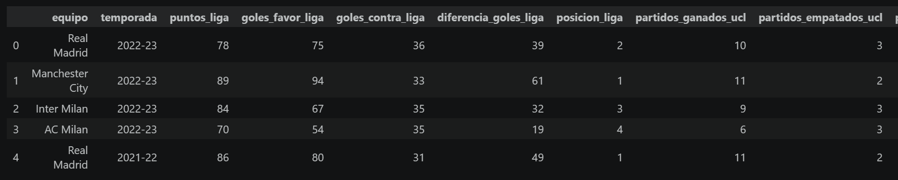
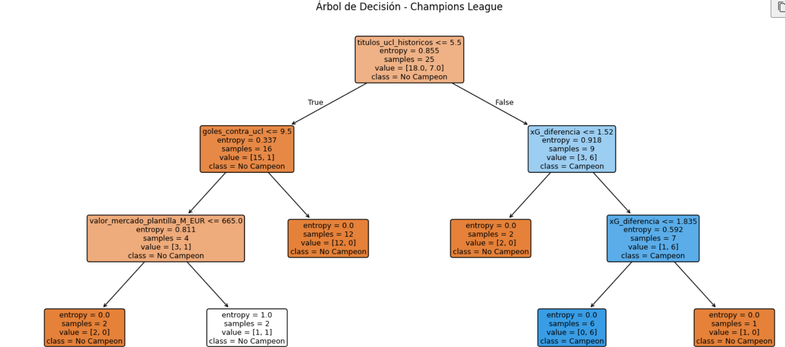
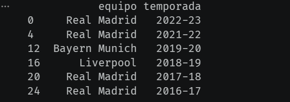

<div align="center">

# ⚽🏆 Champions League: Árbol de Decisión

### ¿Se puede predecir al campeón de la Champions con machine learning?


*Proyecto académico de clasificación con árboles de decisión*

</div>

---

## 📑 Contenido

- [🎯 Objetivo](#-objetivo)
- [📊 Dataset](#-dataset)
- [🧠 Qué hace el proyecto](#-qué-hace-el-proyecto)
- [🌳 El árbol de decisión](#-el-árbol-de-decisión)
- [📈 Resultados](#-resultados)
- [🔍 Análisis honesto de los resultados](#-análisis-honesto-de-los-resultados)
- [🚀 Cómo ejecutarlo](#-cómo-ejecutarlo)
- [🛠️ Próximos pasos](#️-próximos-pasos)
- [📚 Qué aprendí](#-qué-aprendí)
- [👤 Autor](#-autor)

---

## 🎯 Objetivo

Construir un **clasificador binario** que, a partir de estadísticas de un equipo en una temporada de la UEFA Champions League, prediga si ese equipo termina siendo **campeón (1)** o **no campeón (0)**.

Se eligió un **árbol de decisión** porque es un modelo **interpretable**: permite ver exactamente qué variables y qué umbrales usa para decidir.

## 📊 Dataset

- 📁 Archivo: `champions_league_dataset_v2.csv`
- 🧾 **36 registros**, cada uno es un equipo en una temporada (por ejemplo, 2022-23: Real Madrid, Manchester City, Inter y AC Milan)
- 🎯 Variable objetivo: `campeón` (1 = campeón, 0 = no campeón)

<p align="center">
  
</p>

### 🔢 Variables usadas por el modelo (10)

| Variable | Descripción |
|---|---|
| 🏅 `partidos_ganados_ucl` | Partidos ganados en la Champions |
| ⚽ `goles_favor_ucl` | Goles a favor en la Champions |
| 🥅 `goles_contra_ucl` | Goles en contra en la Champions |
| 🎯 `posesion_promedio` | Posesión promedio |
| 📐 `xG_favor` | Goles esperados a favor (xG) |
| ➕ `xG_diferencia` | Diferencia de goles esperados (xG) |
| 💶 `valor_mercado_plantilla_M_EUR` | Valor de mercado de la plantilla (millones de euros) |
| 🏆 `titulos_ucl_historicos` | Títulos de Champions históricos del club |
| 🔥 `indice_forma_ultimos5` | Índice de forma en los últimos 5 partidos |
| 🧤 `clean_sheets_ucl` | Partidos sin recibir gol en la Champions |

## 🧠 Qué hace el proyecto

| Paso | Descripción | Herramientas |
|---|---|---|
| 1️⃣ **Carga de datos** | Lectura del CSV con `pandas` | `pandas` |
| 2️⃣ **Limpieza** | `xG_diferencia` traía el signo menos en formato Unicode (`−`); se reemplazó por `-` y se convirtió a número | `str.replace`, `to_numeric` |
| 3️⃣ **Filtrado** | Se conservaron solo las filas con resultado válido (`campeón` = 0 o 1) | `pandas` |
| 4️⃣ **Selección de variables** | 10 variables numéricas como entrada | `pandas` |
| 5️⃣ **Partición** | 70 % entrenamiento / 30 % prueba (`random_state=1`) | `train_test_split` |
| 6️⃣ **Modelado** | Dos árboles de decisión comparados | `DecisionTreeClassifier` |
| 7️⃣ **Evaluación** | Accuracy sobre el conjunto de prueba | `metrics.accuracy_score` |
| 8️⃣ **Visualización** | Gráfico del árbol entrenado | `plot_tree` |

> 💡 No se escalaron las variables: los árboles de decisión **no lo necesitan**, porque comparan umbrales y no distancias.

## 🌳 El árbol de decisión

Configuración del modelo final:

```python
clf = DecisionTreeClassifier(criterion="entropy", max_depth=3)
clf = clf.fit(X_train, y_train)
```

| Parámetro | Valor | Para qué sirve |
|---|---|---|
| `criterion` | `"entropy"` | Elige las divisiones que más reducen la entropía (desorden) de las clases |
| `max_depth` | `3` | Limita la profundidad para evitar sobreajuste y mantener el árbol legible |

<p align="center">
  
</p>

### 📖 Cómo leer el árbol

| Rama | Regla aprendida | Resultado en entrenamiento |
|---|---|---|
| 🌿 Raíz | `titulos_ucl_historicos <= 5.5` (5 títulos o menos) | 25 equipos: 18 no campeones, 7 campeones |
| ⬅️ Pocos títulos + `goles_contra_ucl > 9.5` | Concede muchos goles | 12 de 12 **no campeones** |
| ⬅️ Pocos títulos + `goles_contra_ucl <= 9.5` | Se mira el valor de plantilla (`<= 665` M€) | 4 equipos: 3 no campeones, 1 campeón |
| ➡️ Muchos títulos + `xG_diferencia <= 1.52` | Diferencia xG baja | 2 de 2 **no campeones** |
| ➡️ Muchos títulos + `1.52 < xG_diferencia <= 1.835` | Diferencia xG media-alta | 6 de 6 **campeones** ✅ |
| ➡️ Muchos títulos + `xG_diferencia > 1.835` | Diferencia xG muy alta | 1 equipo, **no campeón** |

**En palabras simples:** el árbol aprendió que el campeón suele ser un club con una **gran historia en la competición** y una **buena diferencia de goles esperados** en la temporada.

## 📈 Resultados

| Modelo | Accuracy en prueba | Aciertos |
|---|:---:|:---:|
| 🌱 Árbol por defecto (sin límite de profundidad) | 81,82 % | 9 de 11 |
| ✅ Árbol con entropía y `max_depth=3` | **90,91 %** | 10 de 11 |

### 🏆 Equipos que el modelo clasificó como campeones

<p align="center">
  
</p>

> ⚠️ Esta lista se calculó sobre **todo el dataset**, incluidos los datos de entrenamiento. No es una predicción de datos nuevos.

## 🔍 Análisis honesto de los resultados

- 📉 **El conjunto de prueba tiene solo 11 equipos.** Cada acierto vale ~9 puntos porcentuales, así que pasar de 81,82 % a 90,91 % significa **un solo caso más**. Esa diferencia no es estadísticamente sólida.
- ⚖️ **Hay desbalance de clases:** en el entrenamiento solo 7 de 25 equipos (28 %) son campeones. Un modelo que dijera siempre "no campeón" acertaría cerca de un 72 % en esos datos, así que el 81,82 % del primer árbol no está tan lejos de esa línea base.
- 🧐 **La configuración se eligió mirando el conjunto de prueba** (se probó un árbol y luego otro, y se quedó el mejor), lo que sesga un poco el resultado.
- 🏛️ **La variable de la raíz es `titulos_ucl_historicos`:** el modelo parte de la "reputación" del club, lo que favorece a equipos como el Real Madrid o el Bayern. Es una regla útil para este dataset, pero no explica *por qué* se gana una Champions.
- 🎯 **Una regla demasiado estrecha:** el árbol clasifica como campeones a los equipos con `xG_diferencia` entre 1,52 y 1,835, pero como no campeón al único equipo con un valor mayor. Eso es poco lógico (más xG debería ser mejor) y suena a que el modelo se ajustó a un caso concreto.
- ❌ **La lista de "campeones" tiene un error:** aparece el Real Madrid 2022-23, pero ese año el campeón real fue el Manchester City, que no está en la lista.
- 🔄 **El árbol se entrena sin `random_state`**, por lo que el resultado puede variar un poco entre ejecuciones.

### ⚠️ Conclusión

Es un buen ejercicio para entender **cómo piensa un árbol de decisión** y cómo interpretarlo, pero con 36 registros **no es un modelo confiable para predecir campeones reales**.

## 🚀 Cómo ejecutarlo

```bash
# 1. Clonar el repositorio
git clone https://github.com/JohanMonsalveAbello/champions-league-decision-tree.git
cd champions-league-decision-tree

# 2. (Opcional) crear un entorno virtual
python -m venv venv
source venv/bin/activate        # En Windows: venv\Scripts\activate

# 3. Instalar dependencias
pip install -r requirements.txt

# 4. Abrir el notebook
jupyter notebook Champions_League_Decision_Tree.ipynb
```

📦 **Estructura del repositorio**

```text
champions-league-decision-tree/
├── 📓 Champions_League_Decision_Tree.ipynb
├── 📊 champions_league_dataset_v2.csv
├── 🖼️ images/
│   ├── dataset_preview.png
│   ├── decision_tree.png
│   └── predicted_champions.png
├── 📄 requirements.txt
└── 📘 README.md
```

## 🛠️ Próximos pasos

- [ ] Ampliar el dataset con **más temporadas y más equipos**
- [ ] Usar **validación cruzada** en lugar de una sola partición de 11 equipos
- [ ] **Validar por temporada** (entrenar con unas temporadas y probar con una temporada completa no vista)
- [ ] Reportar **matriz de confusión, precisión, recall y F1**, no solo accuracy
- [ ] Comparar contra una **línea base** (predecir siempre "no campeón")
- [ ] Probar **Random Forest** y **Gradient Boosting**, y revisar la importancia de variables
- [ ] Fijar `random_state` para que los resultados sean reproducibles
- [ ] Predecir una temporada nueva con datos que el modelo no haya visto

## 📚 Qué aprendí

- 🌳 Cómo funciona un **árbol de decisión**: divisiones por umbrales, **entropía** y nodos hoja.
- ✂️ Para qué sirve limitar la profundidad (`max_depth`) y cómo ayuda a **controlar el sobreajuste**.
- 🔎 Que un árbol es **interpretable** y que se puede leer como un conjunto de reglas.
- 🧹 Limpiar datos reales: caracteres Unicode en números, filas sin resultado.
- 📏 Que **la accuracy sola engaña** con pocos datos y clases desbalanceadas.
- ⚖️ Que los árboles **no necesitan escalar** las variables.

## 👤 Autor

**Johan Stiven Monsalve Abello**
Estudiante de Ingeniería de Sistemas · Bogotá, Colombia 🇨🇴

[](https://linkedin.com/in/johan-stiven-monsalve-abello-0a61352b1)
[](https://github.com/JohanMonsalveAbello)

---

<div align="center">

⭐ *Proyecto académico de clasificación con árboles de decisión*

</div>
